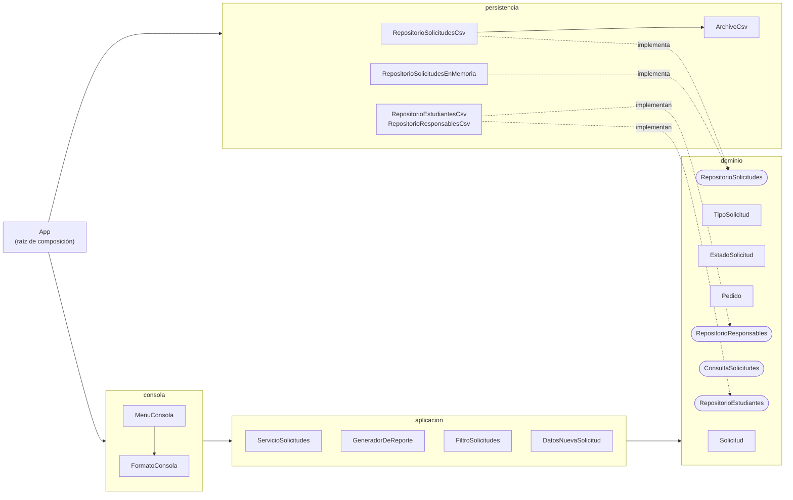

# Etapa 4 - Aplicación de SOLID y Clean Code

## Diseño resultante



Las dependencias apuntan hacia el **dominio**, que no importa ningún otro paquete del proyecto. La consola y
los archivos son detalles: se pueden cambiar sin tocar las reglas.

| Paquete | Responsabilidad | Clases |
|---|---|---|
| `dominio` | Reglas del negocio y contratos de almacenamiento | `Solicitud`, `Pedido`, `TipoSolicitud`, `EstadoSolicitud`, `Prioridad`, `Area`, `Estudiante`, `Responsable`, interfaces de repositorio, excepciones |
| `aplicacion` | Casos de uso y reporte | `ServicioSolicitudes`, `GeneradorDeReporte`, `ReporteSolicitudes`, `FiltroSolicitudes`, `DatosNuevaSolicitud` |
| `persistencia` | Archivos CSV (y una versión en memoria) | `ArchivoCsv`, `RepositorioSolicitudesCsv`, `RepositorioEstudiantesCsv`, `RepositorioResponsablesCsv`, `RepositorioSolicitudesEnMemoria` |
| `consola` | Entrada del operador y textos de pantalla | `MenuConsola`, `FormatoConsola` |
| (raíz) | Arma las piezas | `App` |

## Principios SOLID aplicados

### SRP - Responsabilidad única

**Antes.** `GestorSolicitudes` tenía al menos cinco razones para cambiar: el formato del archivo, una regla de
negocio, un criterio de búsqueda, el contenido del reporte y los textos de pantalla (S01).

**Después.** Cada clase tiene una razón de cambio que se puede decir en una oración:

| Si cambia... | Se modifica solo... |
|---|---|
| una regla de prioridad, plazo o área | `TipoSolicitud` |
| una transición de estado | `EstadoSolicitud` / `Solicitud` |
| el formato del archivo | `RepositorioSolicitudesCsv` / `ArchivoCsv` |
| un texto de pantalla | `FormatoConsola` / `MenuConsola` |
| el contenido del reporte | `GeneradorDeReporte` + `FormatoConsola` |

### OCP - Abierto/cerrado

**Antes.** Agregar un tipo de solicitud obligaba a modificar **8 puntos en 2 archivos** (S04).

**Después.** Se agrega una constante en un solo archivo; el menú, la validación, el reporte y la lectura del
archivo la incorporan solos porque recorren `TipoSolicitud.values()`:

```java
public enum TipoSolicitud {
    CERTIFICADO(Prioridad.BAJA, 3, Area.BEDELIA),
    EXAMEN(Prioridad.MEDIA, 5, Area.BEDELIA),
    EQUIVALENCIA(Prioridad.MEDIA, 30, Area.SECRETARIA_ACADEMICA),
    REVISION(Prioridad.ALTA, 10, Area.SECRETARIA_ACADEMICA),
    BAJA(Prioridad.ALTA, 7, Area.BEDELIA);
    // CONSTANCIA_TITULO(Prioridad.MEDIA, 15, Area.BEDELIA);  <- el pedido del ejemplo: una línea
```

La misma idea se aplicó al menú (CR-04): las opciones son una tabla, no un `switch`.

### LSP - Sustitución de Liskov

`RepositorioSolicitudesCsv` y `RepositorioSolicitudesEnMemoria` implementan `RepositorioSolicitudes` y son
intercambiables. No se da por supuesto: una **prueba de contrato** (`ContratoRepositorioSolicitudes`) define el
comportamiento esperado de cualquier implementación y la heredan las pruebas de ambas: repositorio vacío,
orden, próximo número, reemplazo sin duplicar, lista no modificable y entrega de copias. Gracias a eso, las
pruebas del servicio usan la versión en memoria con la confianza de que se comporta como la de archivo.

### ISP - Segregación de interfaces

Cada cliente depende solo de lo que usa:

| Cliente | Depende de | Métodos |
|---|---|---:|
| `GeneradorDeReporte` | `ConsultaSolicitudes` | 1 (`todas`) |
| `ServicioSolicitudes` | `RepositorioSolicitudes` | 4 |
| `ServicioSolicitudes` | `RepositorioEstudiantes` | 1 (`existe`) |
| `ServicioSolicitudes` | `RepositorioResponsables` | 1 (`buscarPorId`) |

Como las interfaces de un método son funcionales, en las pruebas se reemplazan con una lambda:
`RepositorioEstudiantes soloExiste1001 = "1001"::equals;`.

### DIP - Inversión de dependencias

**Antes.** La lógica creaba sus dependencias: `new FileReader("datos/...")`, `LocalDate.now()`, `System.out`
(S07). Probar una regla exigía archivos reales, consola y la fecha del día.

**Después.** Las clases reciben abstracciones por constructor y solo `App` decide las implementaciones:

```java
public ServicioSolicitudes(RepositorioSolicitudes solicitudes, RepositorioEstudiantes estudiantes,
                           RepositorioResponsables responsables, Clock reloj)
```

El reloj (`java.time.Clock`) permite probar vencimientos con una fecha fija; la consola recibe un `Scanner` y un
`PrintStream`, por eso el menú se prueba en memoria.

## Clean Code aplicado

| Práctica | Antes | Después | Evidencia |
|---|---|---|---|
| Nombres que revelan intención | `g`, `p`, `s`, `va`, `res`; `cerradas` contaba resueltas | `gestor` → `servicio`, `prioridad`, `encontradas`, `diasDeResolucion()` | PMD `ShortVariable`: 31 → 0 |
| Funciones pequeñas, un nivel de abstracción | `registrarSolicitud`: 101 líneas, complejidad 29 | `registrar`: 11 líneas que se leen como la regla | Método más largo: 101 → 20 líneas |
| Sin literales mágicos | 58 textos de tipo, estado y prioridad | Enums; constantes con nombre (`LARGO_MAXIMO_DESCRIPCION`, `PLAZO_MINIMO_EN_DIAS`) | Literales de regla: 58 → 0 |
| Manejo de errores con excepciones | `println("Error...")` + `return`; `catch (Exception e) {}` | `ReglaDeNegocioException`, `ErrorDePersistencia`; la consola decide el texto | `EmptyCatchBlock` y `AvoidCatchingGenericException`: 7 → 0 |
| Encapsulamiento | Campos públicos; nada impedía `estado = "CUALQUIERA"` | Campos privados; los cambios pasan por métodos que validan | PMD `DataClass`: 2 → 0 |
| Sin código muerto | `esUrgente()` sin uso, código comentado | Eliminado (el historial de git lo conserva) | `UnusedPrivateMethod`: 1 → 0 |
| Comentarios que explican el porqué | "// busco el id mas alto" | Javadoc de contrato y decisiones (por ejemplo, por qué el promedio usa el locale de la máquina) | Revisión B5 |
| Cohesión y límites | Una clase con todo | 5 paquetes con dependencias en una sola dirección | Revisión A6 |

### Ejemplo: el caso de uso se lee como la regla

```java
/** Registra una solicitud nueva. Las validaciones siguen el orden: legajo, tipo, descripcion. */
public Solicitud registrar(DatosNuevaSolicitud datos) {
    if (!estudiantes.existe(datos.legajo())) {
        throw new ReglaDeNegocioException("no existe un estudiante con legajo " + datos.legajo());
    }
    TipoSolicitud tipo = TipoSolicitud.desde(datos.tipo())
            .orElseThrow(() -> new ReglaDeNegocioException("tipo de solicitud invalido"));
    Pedido pedido = new Pedido(datos.legajo(), tipo, datos.descripcion(), datos.urgente());
    Solicitud solicitud = Solicitud.registrar(solicitudes.proximoNumero(), pedido, hoy());
    solicitudes.guardar(solicitud);
    return solicitud;
}
```

## Métricas antes y después

| Métrica | `estado-inicial` | `estado-refactorizado` |
|---|---:|---:|
| Archivos Java | 5 | 29 |
| Líneas de código (sin comentarios) | 501 | 943 |
| Líneas del archivo más grande | 401 | 158 |
| Línea del método más largo | 101 | 20 |
| Complejidad ciclomática máxima de un método | 29 | 7 |
| Máximo de parámetros | 5 | 4 |
| Literales de tipo, estado o prioridad | 58 | 0 |
| Hallazgos PMD (reglas de diseño) | 154 | 3 (aceptados, CR-06) |
| Lugares a tocar para agregar un tipo | 8 | 1 |
| Pruebas automatizadas | 0 | 133 |
| Cobertura de líneas | 0% | 95% |

El total de líneas **creció**: hay más clases, cada una con su firma, y más código explícito. Es el costo de
separar responsabilidades. Lo que importa para mantener es que **cada pieza es chica y se entiende sola**: el
archivo más grande bajó de 401 a 158 líneas y ningún método supera 20.

Fuentes: [métricas iniciales](evidencias/estado-inicial/metricas.md), [métricas finales](evidencias/estado-refactorizado/metricas.md),
[PMD inicial](evidencias/estado-inicial/pmd-resumen.md), [PMD final](evidencias/estado-refactorizado/pmd-resumen.md).
